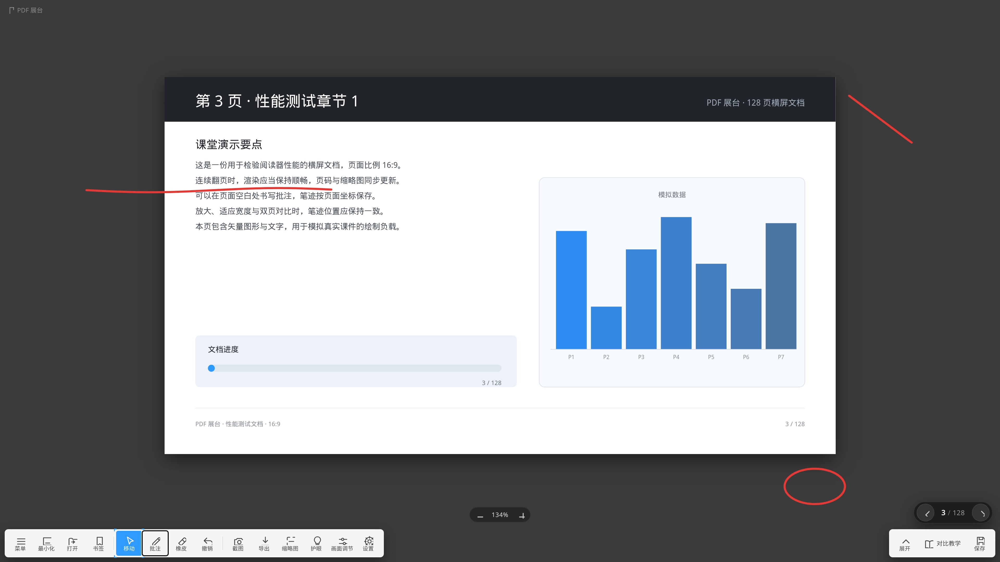
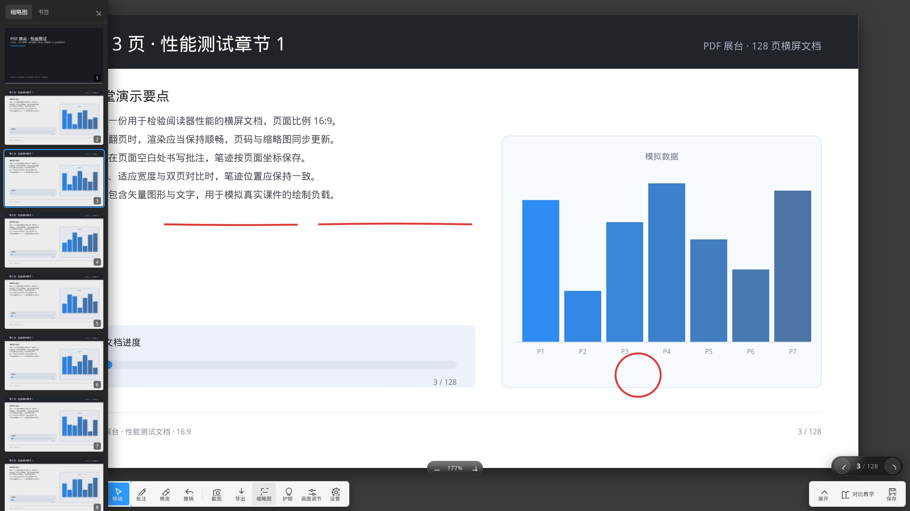
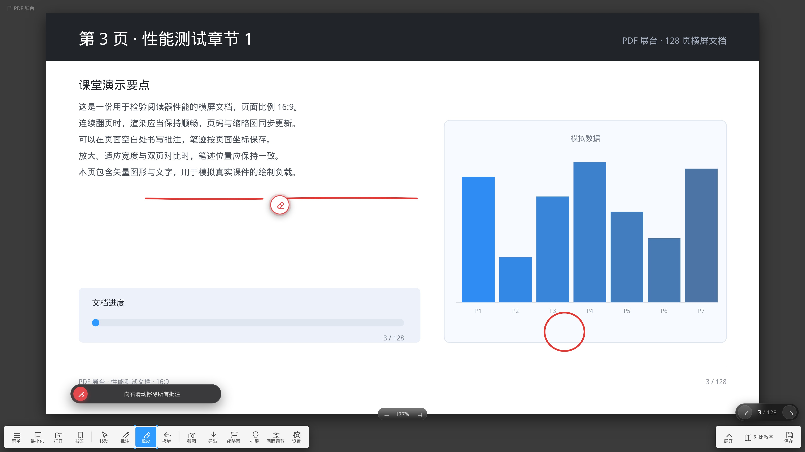
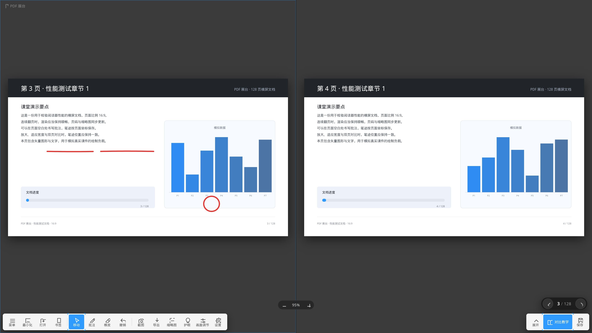
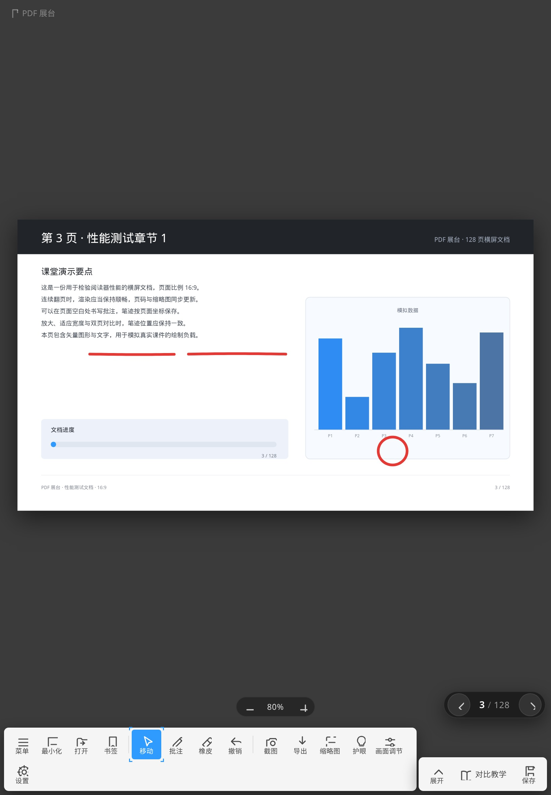

# PDF 展台

> 仿希沃视频展台操作手感的 PDF 阅读器：批注可画到页面外，橡皮擦到哪就擦到哪，128 页横屏文档 1.2 秒打开。
> 同一套前端，打包为 Windows / macOS / Linux / Android 四个平台。



## 功能

- **横竖屏都不裁切**：平板竖屏时工具条自动换行，翻页器与缩放条按工具条高度动态让位。
- **批注可越界**：输入层覆盖整个窗格，笔迹能落在页面外的灰色空白处；笔画按 PDF 坐标保存，缩放后位置不变。
- **橡皮跟随图标**：按下后出现圆形橡皮图标，擦除范围就是图标中心经过的地方，命中的笔画被**分段裁剪**，不会整条消失。
- **右滑清空**：点橡皮后按钮上方出现「向右滑动擦除所有批注」滑动条，滑到底清空，可撤销。
- **双页对比**：左右分栏、各自独立批注、翻页同步；竖屏自动改为上下排列。
- **像图片一样翻页**：左右滑动跟手翻页，右下角为希沃白板同款翻页控件。
- **性能**：128 页 16:9 横屏文档打开约 1.2 秒，连续翻页约 20ms/页，缩略图按可视区懒加载。
- **导出**：批注可烘焙进 PDF 一并导出；本地 localStorage 持久化，不上传任何文件。

## 截图

| 128 页横屏 | 橡皮与右滑清空 | 双页对比 |
| --- | --- | --- |
|  |  |  |

竖屏平板（工具条自动换行、图标完整显示）：



## 下载

到 [Releases](https://github.com/Gailv748/pdf-stage/releases/latest) 下载：

| 平台 | 文件 | 说明 |
| --- | --- | --- |
| Windows x64 | `PDFStage-Windows-x64-portable.zip` | Win 10 / 11 |
| Windows x86 | `PDFStage-Windows-x86-portable.zip` | Win 7 / 8 / 8.1 |
| macOS Apple Silicon | `PDFStage-macOS-AppleSilicon.zip` | M1 / M2 / M3 / M4 |
| macOS Intel | `PDFStage-macOS-Intel.zip` | x64 |
| Linux x64 | `PDFStage-Linux-x64-portable.tar.gz` | 解压后运行 `启动.sh` |
| Android | `PDFStage-Android-universal-v1.0.apk` | arm64 + x86 通用，Android 5.0+ |
| 测试文档 | `PDFStage-Test-128pages.pdf` | 128 页 16:9 横屏性能测试 |

> macOS 未签名：首次右键 →「打开」，或 `xattr -cr "/Applications/PDF 展台.app"`。
> Android 安装包约 2.18 MB，若明显不符说明下载被截断。

浏览器直接使用：打开 `web/index.html` 即可（需通过 http 访问以加载 pdf.js worker，例如 `python3 -m http.server`）。

## 目录结构

```
web/      前端主体（HTML/CSS/JS + pdf.js + pdf-lib）
windows/  Electron 打包脚本（x64 / ia32）
mac/      Electron 打包脚本（darwin x64 / arm64）
linux/    Electron 打包脚本（linux x64）
android/  纯 Java + WebView，aapt2 + d8 + apksigner 手工构建
site/     官网与 4K 宣传片（GitHub Pages）
sample/   演示课件与 128 页性能测试 PDF
tools/    截图、测试与资源生成脚本
```

## 本地运行

```bash
cd web && python3 -m http.server 8123
# 浏览器打开 http://127.0.0.1:8123/index.html
```

## 构建

```bash
./windows/build.sh   # 产出 windows/dist/*.zip
./mac/build.sh       # 产出 mac/dist/*.zip
./linux/build.sh     # 产出 linux/dist/*.tar.gz
./android/build.sh   # 产出 android/dist/*.apk（含签名与 ZIP 完整性自检）
```

桌面端使用 Electron 22（兼容 Win7 的最后一条主线）与 `@electron/packager`；Android 端不使用 Gradle，直接用 build-tools 手工打包，`minSdk 21 / targetSdk 34`。

## 宣传片

`site/promo.html` 是 3840×2160 的 HTML 宣传片，`?record=1` 关闭所有控件，`window.__seek(t)` 提供确定性时间轴，可逐帧导出后用 ffmpeg 合成 4K60 视频：

```bash
node tools/frames.js /tmp/promo-frames 60
ffmpeg -framerate 60 -i /tmp/promo-frames/f%05d.jpg -c:v libx264 -crf 21 -pix_fmt yuv420p out.mp4
```

## 技术栈

pdf.js 2.16 · pdf-lib 1.17 · SVG 批注层（PDF 原始坐标 + `non-scaling-stroke`）· Electron 22 · Android WebView。

## 许可

MIT
